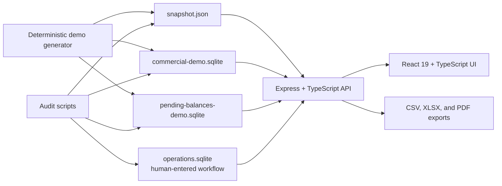

# SMART Salice

SMART Salice is an operational and analytical workspace for a regional pet-supply distributor. It connects customers, sellers, collections, products, routes, goals, and sales drill-downs in one auditable desktop-first application.

> Privacy note: this hackathon edition contains only deterministic fictional data. Every customer, seller, product, transaction, balance, address, email, and business result in the demo is invented. It makes no network request to an ERP and requires no credentials or environment configuration.

## The problem

Distribution offices often split decisions across dashboards, spreadsheets, an ERP, and personal notes. A dashboard can show a decline or overdue balance, but it cannot own the next visit, payment promise, review state, or route.

SMART Salice turns those disconnected signals into an operational loop:

1. Find a risk, decline, or opportunity.
2. Drill from an aggregate to a seller, customer, product, or document.
3. Record the human decision separately from analytical facts.
4. Revisit the result through an auditable history.

## What the demo shows

- Operational customer map and complete customer profiles
- Seller portfolios, sales, debt, risk, territory, and priorities
- Agenda for visits, calls, offers, collections, and follow-ups
- Accounts receivable, aging, promises, and document drill-down
- Sales explorer with a single filter universe and CSV/XLSX export
- Versioned commercial goals with explicit activation and history
- Product catalog, comparison, and 33-dimensional vector evidence
- Explainable product recommendations with confidence and peer adoption
- Route planning with time, distance, and feasibility guardrails
- Data quality, source coverage, and local audit summaries
- Interactive guided tour for a reliable judge walkthrough

The three scores remain deliberately separate:

| Score | Meaning | Role |
| --- | --- | --- |
| C | Collection risk | Financial exposure and payment behavior |
| O | Commercial opportunity | Recency, decline, inactivity, and assortment breadth |
| P | Visit priority | A transparent 58% C / 42% O operational ranking |

P is a prioritization rule, not a prediction. Recommendations and vectors are deterministic and show their evidence rather than presenting an opaque model score.

## Architecture



Analytical facts and human-entered operations never share a source table. Regenerating the fictional analytical pack does not overwrite notes, review marks, goals, promises, or follow-up history.

More detail: [Architecture and data flow](docs/ARCHITECTURE.md).

## Run locally

Requirements:

- Node.js 22 or newer
- pnpm 10 or newer

```bash
pnpm install
pnpm run prepare:demo
pnpm run dev
```

Open [http://localhost:5173](http://localhost:5173). The first startup can also create the deterministic demo files automatically.

Production-mode check:

```bash
pnpm run build
pnpm start
```

Then open [http://127.0.0.1:8787](http://127.0.0.1:8787).

No `.env` file is needed. Generated JSON and SQLite files live under `data/` and are intentionally ignored by Git.

## Verify the submission

```bash
pnpm test
pnpm run build
pnpm run prepare:demo
pnpm run audit:data
pnpm run audit:commercial-data
pnpm run audit:vectors
pnpm run audit:operations
pnpm run audit:platform
```

The audit chain checks deterministic generation, database integrity, metric invariants, vector quality, operational persistence, and cross-source consistency. Current validation evidence is recorded in [Validation](docs/VALIDATION.md).

## Main implementation decisions

- Local-only hackathon runtime: no live ERP, authentication, external service, or secret is required.
- Fully fictional demo pack: safe to screen-record, publish, reset, and reproduce.
- Signed movements: invoices are positive and credit notes are negative in every report universe.
- Centralized metric rules: report filters, ratios, shares, and comparison periods have named reusable definitions.
- Separate operational persistence: human actions remain distinct from analytical facts.
- Honest missingness: absent detail is shown as unavailable and is never fabricated.
- Explainable algorithms: route and recommendation scores expose rules, evidence, and confidence.

## Built with Codex and GPT-5.6

The project was started on July 15, 2026 and developed during the hackathon eligibility window. The human owner defined the business rules, privacy boundary, scope, and final product decisions. Codex using GPT-5.6 acted as an engineering and product collaborator by:

- auditing the existing architecture and locating every data consumer;
- isolating a hackathon branch and protecting the stable product branch;
- replacing live connectivity with a deterministic fictional data generator;
- removing credential-dependent workflows and confidential artifacts;
- translating and polishing the judge-facing product surface;
- converting snapshot-pinned tests into synthetic invariants;
- validating builds, tests, databases, audits, and the browser demo path;
- preparing architecture, demo, submission, and safety documentation.

The human explicitly chose to keep C, O, and P separate; reject opaque AI claims; avoid scope expansion into authentication or mobile field workflows; and publish only synthetic data. A Codex Session ID is obtained through `/feedback` and included in the Devpost submission.

## Implemented versus roadmap

Implemented in this repository: the complete local synthetic workflow described above.

Out of scope for the hackathon: live ERP refresh, authentication, production multiuser concurrency, drivers, suppliers, mobile field operations, and multitenancy. These are not represented as completed features.

## Demo and submission

- [Live-demo script and fallback paths](docs/DEMO_SCRIPT.md)
- [Architecture and data flow](docs/ARCHITECTURE.md)
- [Security and synthetic-data policy](docs/SECURITY_AND_DATA.md)
- [Judge description, pitch, Q&A, and video plan](docs/SUBMISSION.md)
- [Final checklist](docs/FINAL_CHECKLIST.md)

## Technology

React 19, TypeScript, Vite, Express, SQLite, Leaflet, OpenStreetMap, Lucide Icons, ExcelJS, and PDFKit.

## License and use

Hackathon evaluation build. The fictional demo records may be regenerated locally; they must not be interpreted as real company performance.
