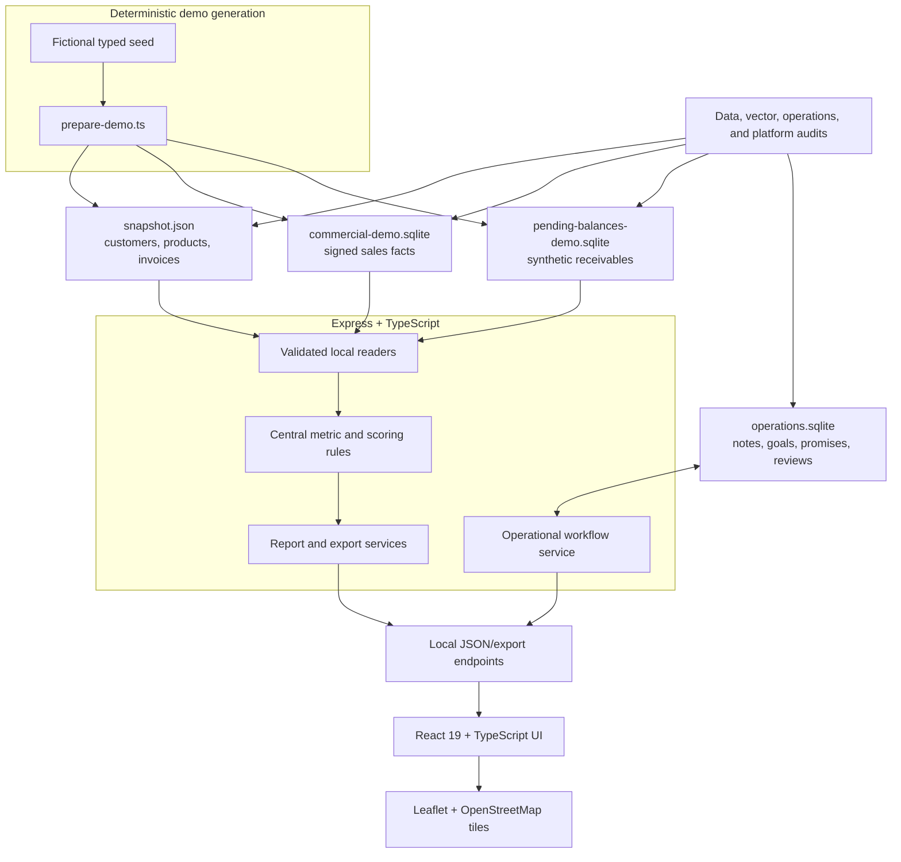
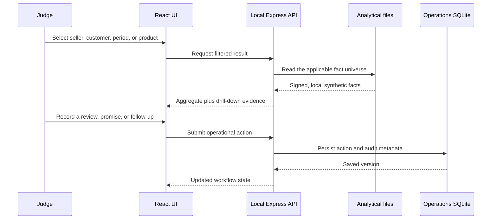

# Architecture and data flow

SMART Salice is a desktop-first React application backed by a local Express API. The hackathon build is deliberately self-contained: it reads deterministic fictional files from `data/`, persists human-entered workflow in a separate SQLite database, and makes no request to an ERP or other business system.

## Runtime structure

The only optional network traffic is the standard OpenStreetMap basemap requested by Leaflet. The business dataset, calculations, and workflows remain fully local; the application continues to work without map tiles.

## Data boundaries

| Layer | File | Purpose | Reset behavior |
| --- | --- | --- | --- |
| Validated demo snapshot | `data/snapshot.json` | Customers, products, invoices, balances, and recommendation inputs | Rebuilt deterministically |
| Commercial facts | `data/commercial-demo.sqlite` | Signed sales movements and report dimensions | Rebuilt deterministically |
| Pending balances | `data/pending-balances-demo.sqlite` | Synthetic document-level receivables | Rebuilt deterministically |
| Operational workflow | `data/operations.sqlite` | Notes, visits, promises, review ticks, goals, and audit history | Preserved unless explicitly reset |

Generated files are excluded from Git. `pnpm run prepare:demo` recreates the analytical pack from committed fictional seeds, which keeps the repository small and makes the evidence reproducible.

## Request flow

## Central business rules

- Invoices contribute positive movement; credit notes contribute negative movement.
- Period comparisons use named, reusable date windows instead of view-specific arithmetic.
- C measures collection risk, O measures commercial opportunity, and P ranks visits using 58% C and 42% O. The three values are never presented as one predictive model.
- Product comparison uses 33 readable dimensions. Recommendation evidence names the matching dimensions, confidence, and peer adoption.
- Route planning exposes travel time, distance, service duration, and feasibility warnings.
- Missing detail stays missing. The application never invents a line item or mapping to complete a report.

## Auditability

Metric definitions live in `shared/metrics.ts`; recommendation and route rules live in `shared/algorithms.ts`; vector construction lives in `shared/product-vectors.ts`. Views consume those definitions rather than redefining them. Operational mutations append audit information in the local operations database, while analytical data stays immutable during normal use.

## Deliberate scope

The hackathon build does not include live data refresh, credentials, authentication, multitenancy, mobile field workflows, suppliers, drivers, or production concurrency. Those exclusions keep the demo safe, deterministic, and aligned with the implemented office workflow.
